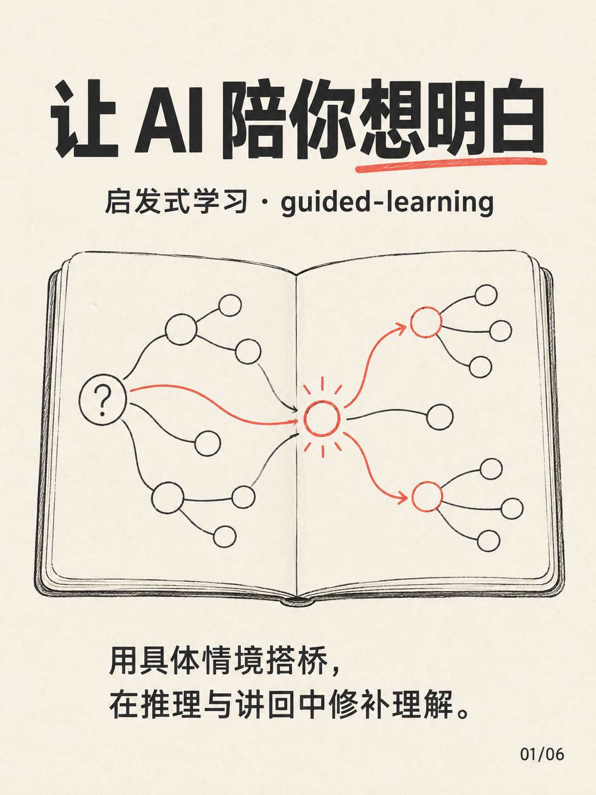
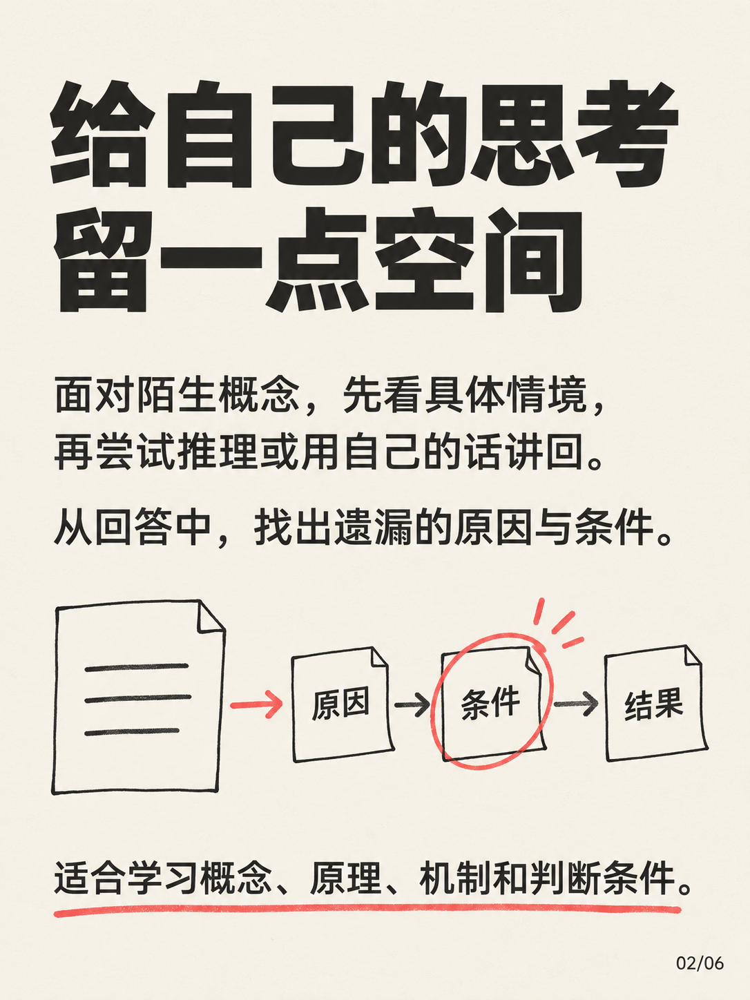
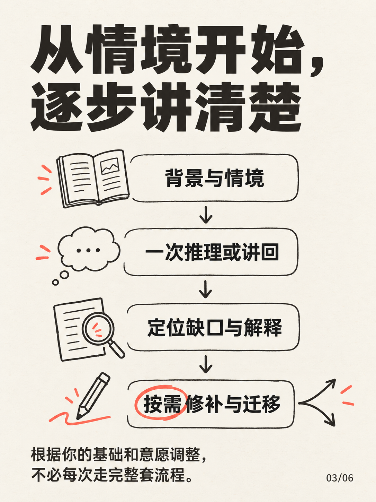
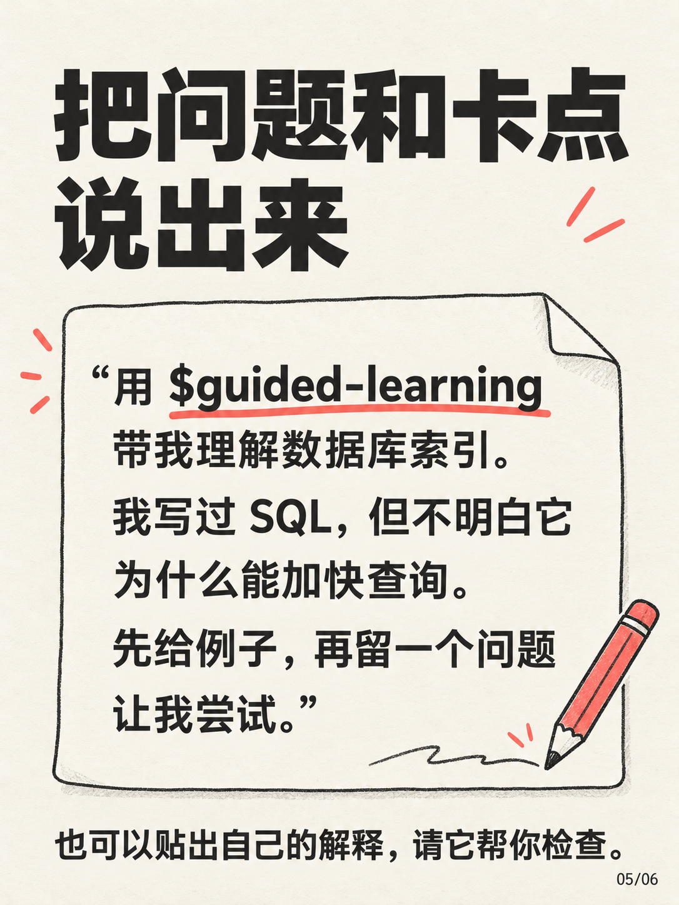
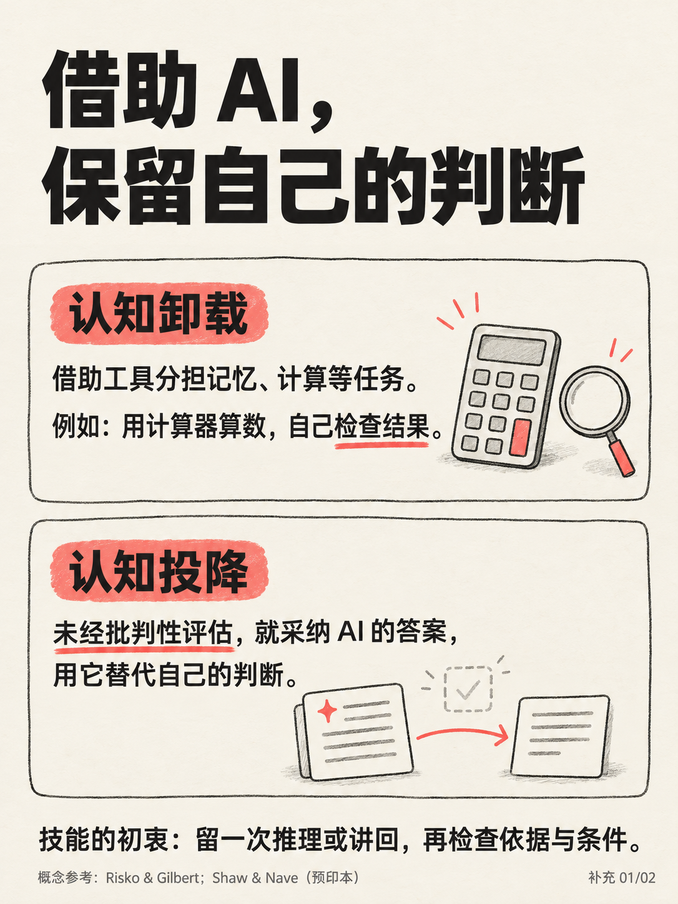
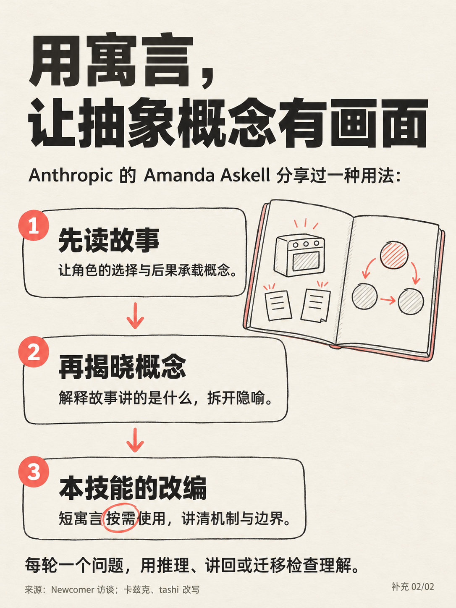

# Guided Learning · 启发式学习

一个帮助你理解陌生专业知识的 Agent Skill：用背景与具体情境搭桥，通过一次推理或用自己的话讲回发现理解缺口，随后解释、修补，并在有价值时换个情境检验应用。

An Agent Skill for learning unfamiliar concepts through brief context, concrete examples or optional fables, one reasoning or explain-back task, and feedback that identifies gaps. The same instruction package can be loaded by Codex, WorkBuddy, Hermes, and other agents that support the Agent Skills format. It follows the learner's language and switches to a complete explanation whenever requested.

[Skill 指令](SKILL.md) · [安装与兼容性](INSTALL.md) · [SkillHub](https://skillhub.cn/skills/user_2d01d3cb/guided-learning) · [教学示例](references/teaching-examples.md) · [设计来源](references/design-basis.md) · [MIT License](LICENSE)

点击任意图解可查看原图。

<p align="center">
  <a href="assets/intro/01.png"></a>
  <a href="assets/intro/02.png"></a>
</p>

## 它如何帮助你 / How it helps

默认节奏：**背景与情境 → 一次推理或讲回 → 定位缺口与解释 → 必要时修补和迁移**。根据你的基础与已有回答调整，不要求每次走完固定流程。

<p align="center">
  <a href="assets/intro/03.png"></a>
  <a href="assets/intro/04.png"></a>
</p>

- **初次接触一个领域**：先解释必要术语，给出具体案例；抽象关系难以直观理解时，可用短寓言呈现，再说明其对应关系与边界。
- **检验自己的理解**：用自己的话或简图讲清一条机制，检查是否只记住故事、遗漏因果关系或忽略关键条件；修补时只聚焦最影响判断的一处。
- **已经有自己的判断**：直接检验你的依据与推理。
- **完全不知道或卡住了**：补充背景、示范完整思路；同一学习点默认最多追加一次得到帮助后的尝试，提示后再猜与修补后再讲回共用次数。
- **希望继续应用**：换一个关键条件检验应用或识别失效，分别观察讲回与迁移的表现。
- **需要直接答案或实际交付物**：立即满足请求，可以随时退出提问模式。

适合希望理解概念、原理、机制和判断条件的学习请求。只查事实、赶时间或需要完成工作时，不强制进入教学流程。

## 安装与兼容性 / Install across agents

核心包使用 [Agent Skills 标准](https://agentskills.io/specification)的 `SKILL.md` 与相对路径参考文件，无需安装教学运行依赖或填写 API 密钥。联网用于有需要时核验事实；无法联网时会明确保留未核验部分。

| Agent / 入口 | 安装方式 | 调用示例 |
|---|---|---|
| Codex | 将 `guided-learning` 放入 `~/.agents/skills/`，或用内置 skill-installer | `$guided-learning 带我理解数据库索引` |
| WorkBuddy | 技能 → 添加技能 → 上传技能，导入 ZIP；也可使用 SkillHub 页面提供的 WorkBuddy 入口 | `请使用 guided-learning（启发式学习）带我理解数据库索引` |
| Hermes | 放入当前配置的 skills 目录，或将共享 skills 目录加入 `skills.external_dirs` | `/guided-learning 带我理解数据库索引` |
| 其他支持 Agent Skills 的 agent | 按其文档导入完整技能目录，保留 `SKILL.md` 与 `references/` 的相对位置 | 使用宿主的技能选择器或自然语言名称 |
| 不支持技能加载的聊天工具 | 将 `SKILL.md` 正文放入本次会话指令；需要示例或来源时再附对应参考文件 | `按上面的启发式学习流程带我理解数据库索引` |

完整命令、Hermes 共享目录配置、SkillHub 安装提示与排查方法见 [安装与兼容性说明](INSTALL.md)。各宿主是否自动选择技能、如何导入和刷新，由对应产品决定；通用格式适配不等于已在每个版本中完成端到端验证。

### SkillHub 与发布包

技能已上架 [SkillHub：启发式学习](https://skillhub.cn/skills/user_2d01d3cb/guided-learning)。更新仓库不会自动替换 SkillHub 中已上传的版本；可用以下命令生成重新上传或导入 WorkBuddy 的轻量包：

```bash
python scripts/package_skill.py
```

输出为 `dist/guided-learning.zip`，ZIP 根目录直接包含 `SKILL.md`、两份教学参考、MIT 许可证、可选的 OpenAI 元数据与图标，并以安装说明作为包内 `README.md`。介绍图片保留在本仓库展示，发布包使用在线链接查看图文介绍。此脚本仅用于维护者打包，需要 Python 3 标准库，不是使用技能的依赖。

## 使用示例 / Try it

<p align="center">
  <a href="assets/intro/05.png"></a>
  <a href="assets/intro/06.png"></a>
</p>

```text
请使用 guided-learning（启发式学习）带我理解：为什么输电要提高电压？
我是新手，先给必要背景和例子，再提出一个问题让我尝试。
```

```text
请使用 guided-learning 带我理解数据库索引。我写过 SQL，但不清楚索引为何能加快查询。
```

```text
请使用 guided-learning 帮我检查对机会成本的理解。我认为它就是选错以后少赚的钱。
请从我的解释中找出关键缺口，帮我修补，再按需换个情境检验。
```

```text
Use the guided-learning skill to help me understand HTTP caching.
I'm new to it. Give me a concrete example, then one question to reason through.
```

随时可以说“我完全不知道，先示范”或“我赶时间，直接讲完，不用提问”。

## 仓库内容 / Files

```text
guided-learning/
├── SKILL.md                         核心指令与触发范围
├── agents/openai.yaml               界面元数据与调用策略
├── assets/
│   ├── icon.svg                    图标
│   └── intro/                       八张介绍图（01.png–08.png）与提示词、来源
├── references/
│   ├── teaching-examples.md          寓言映射、推理、讲回修补和迁移示例
│   └── design-basis.md               寓言、费曼式学习及研究证据边界
├── README.md
├── INSTALL.md                       跨 Agent 安装、调用与兼容性说明
├── scripts/package_skill.py         维护者发布包生成工具（不进入 ZIP）
└── LICENSE
```

## 设计依据与贡献 / Design and contributions

创作初衷参考 Renx 发布于“启元洞见”的[《当 AI 代替人类承担“思考的阵痛”，它在如何重塑人类认知架构？》](https://mp.weixin.qq.com/s/7_ET-5fNRlcJKxtB4tkYBg)。我们希望在 AI 分担记忆、计算等任务时，仍为学习者保留尝试推理、检查依据和条件的空间；同时尊重用户的基础、意愿与学习节奏。

<p align="center">
  <a href="assets/intro/07.png"></a>
  <a href="assets/intro/08.png"></a>
</p>

这是可调整的教学流程。寓言部分通过 `fable-writing` 技能，借鉴“数字生命卡兹克”发布的[《分享一个很实用的寓言故事prompt，5分钟帮你理解任何新概念。》](https://mp.weixin.qq.com/s/L1ISA0FvxY_7OR994RttWw)（文末署名：卡兹克、tashi）中的寓言写作 Prompt，将故事、概念映射和理解／迁移检验改编为按需使用、每轮一个核心任务的教学方式。

该文章追溯的上游启发是 Anthropic 的 Amanda Askell 在 [Newcomer 访谈](https://podcast.newcomer.co/episode/amanda-askell-on-ai-consciousness-claude-amp-silicon-valleys-biggest-fear)（53:20 起）中的个人使用分享：先让寓言间接呈现概念，再在故事后揭晓和解释概念。本技能进一步加入短寓言的按需选择、机制与边界说明，以及推理、讲回或迁移检查。八张图的完整提示词与补充参考来源见 [图解制作记录](assets/intro/prompts.md)。

同时借鉴费曼式学习中的解释、发现缺口与修补。这些都是设计启发；原文中的学习效果描述不构成本 skill 的实证依据。没有实证证明此 skill 能改善长期记忆或认知能力，流畅复述也不能代替新情境应用的证据。完整来源关系、费曼本人表述与流行四步法的区分，以及研究能支持的结论见 [设计来源与证据边界](references/design-basis.md)。

欢迎通过 [Issues](https://github.com/cliffffffffff/guided-learning/issues) 反馈具体学习情境，也欢迎提交 PR 改进指令和示例。请说明原有行为、期望行为与具体例子，并保留用户随时获得直接答案的选择。

The instructions and examples are written in Chinese; the skill asks the agent to use the learner's language. Share concrete learning scenarios in Issues or PRs. This is an instructional design, with no claim of proven long-term cognitive or memory benefits.

## 许可证 / License

[MIT](LICENSE) — Copyright (c) 2026 cliffffffffff. 外部链接所指文章和论文仍适用各自的版权与使用条款。
